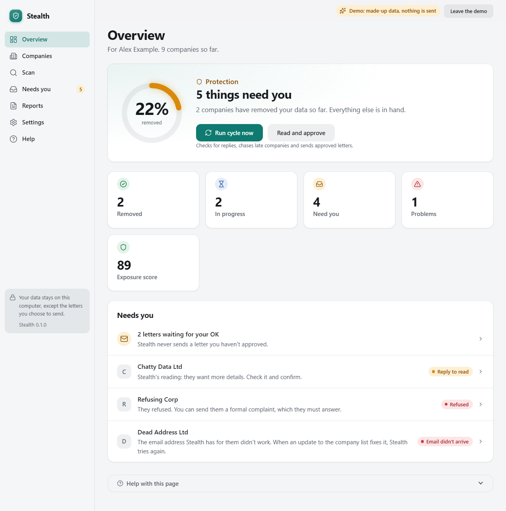
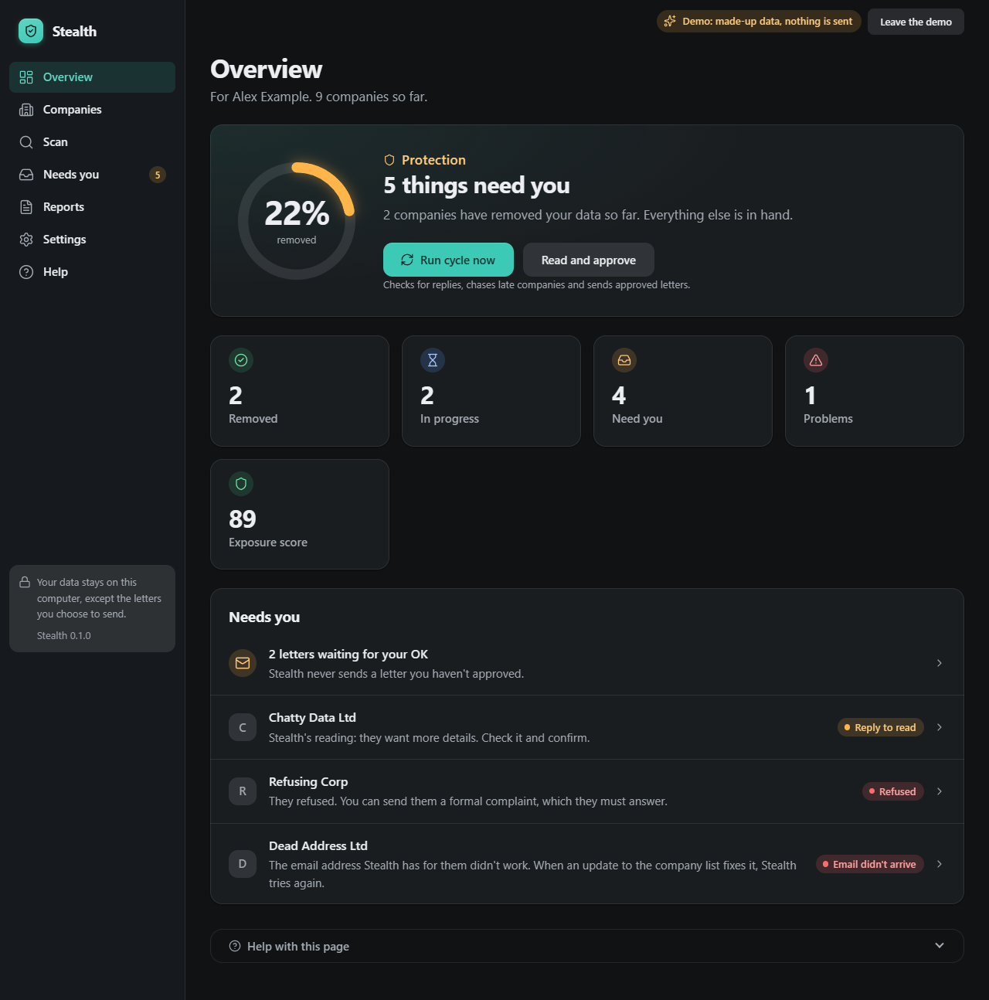
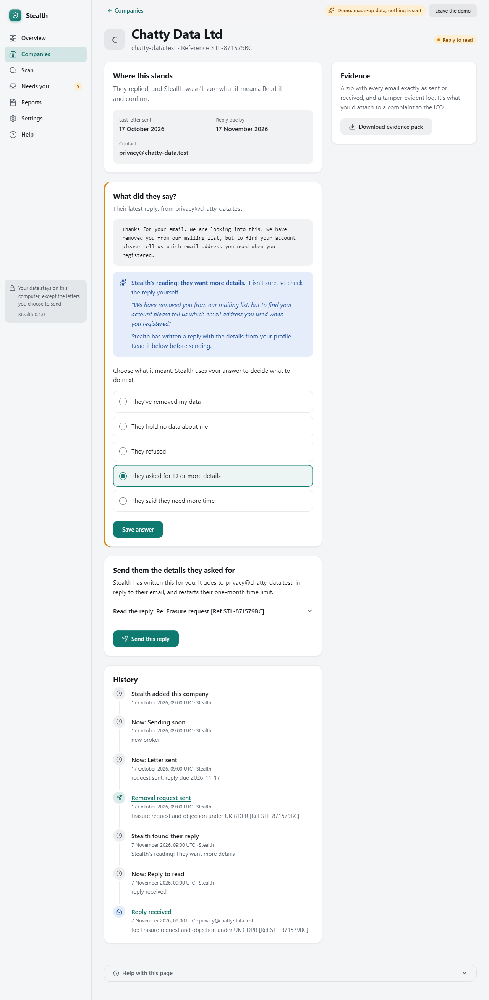
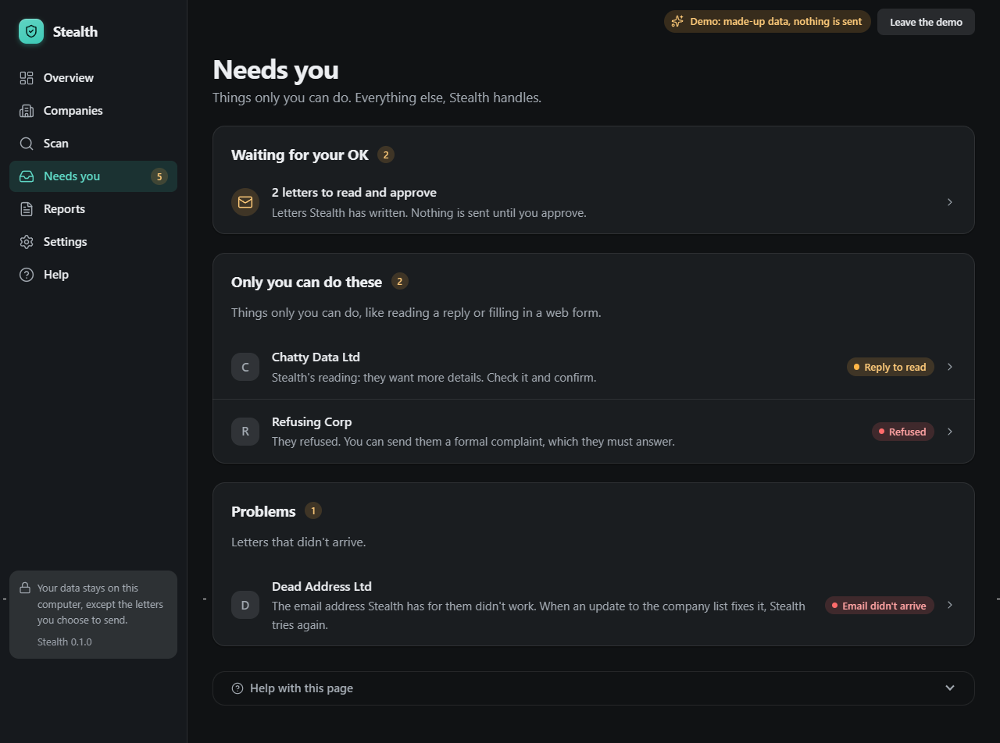

# Stealth

Free, open-source personal data removal for people in the UK. Stealth writes to the companies that
sell your data, tells them to delete it, keeps track of who answered, and helps you escalate to the
Information Commissioner's Office (ICO) when they don't. It runs on your own computer. There is no
account, no server and no telemetry.

**Status: Phase 2 of 4, in progress.** The engine, command line and desktop dashboard work
today, and installers are built and tested on every change. The desktop app sets itself up in six
steps, with Gmail, Yahoo, iCloud or any provider that allows app passwords. Outlook and Hotmail
need Microsoft sign-in, which is still to come.

**macOS is untested for now.** The Mac build is made and checked in CI, but its window doesn't
load yet ([#1](https://github.com/Anish25012/stealth/issues/1)) and nobody has tried it on a real
Mac. Windows is the supported platform.

## What works today

- Letters citing UK GDPR Articles 17, 19, 21, 12(3) and 12A, stating the exact reply-by date
- Preview by default: nothing is sent until you add `--live`
- A daily sending limit and pacing, so your mailbox isn't flagged for bulk sending
- Reply detection that only reads your mailbox and never changes it
- A reply reader: clear answers ("deleted", "we hold nothing", "we need more time", "send ID",
  refusals) are recorded automatically, acknowledgements are filed quietly, and unclear replies come
  to you with Stealth's best guess
- Drafted answers to requests for ID or more details, citing Article 12(6)
- Bounce detection, which flags dead contacts
- A formal complaint under section 164A of the Data Protection Act 2018 once the deadline passes
- A drafted ICO complaint when a company has had its chance
- Repeat requests after 60 days for people-search sites and 90 days for others, because brokers
  re-list people
- An encrypted database, with keys in your operating system's keychain
- A tamper-evident audit log: every email sent and received is kept with a hash
- A UK checklist of steps only you can do
- `stealth demo`, a full fake cycle that sends no real email
- A desktop dashboard: every company and where it stands, each one's full history, replies shown
  as plain text, a downloadable evidence pack per company, and a "Run cycle now" button
- Approve before send: in the desktop app, every letter waits for your OK first
- A demo inside the app ("Try the demo") that sends nothing anywhere
- Help on every screen, and error screens with details you can copy to whoever helps you
- Light and dark mode that follow Windows, with a choice in Settings
- Setup in the app: who it's for (with consent recorded when it's someone else), their details,
  email checked before anything is saved, a recovery code, and the companies to write to
- More than one person, each kept separately, from Settings > People
- Runs by itself once a day, with catch-up after the computer was off, tray notifications, and an
  optional start with Windows
- Add any company by its website: Stealth reads its privacy policy, puts the likeliest privacy
  address first with the words it was found next to, and you choose
- An assisted people-search scan: Stealth opens your own Edge or Chrome (in a separate, empty
  profile), you search for yourself, and Stealth captures the page as evidence. A listing you
  confirm goes in the letter, and a later capture without you proves it's gone
- An exposure score out of 100, with its formula on screen

## Screenshots

These are from the demo, so the details are made up.

| Light | Dark |
|---|---|
|  |  |
|  |  |

More, in both themes: [welcome](docs/screenshots/welcome-light.png),
[companies](docs/screenshots/companies-light.png),
[approving letters](docs/screenshots/approve-light.png),
[reports](docs/screenshots/reports-light.png), [scan](docs/screenshots/scan-light.png),
[adding a company](docs/screenshots/add-company-light.png), [settings](docs/screenshots/settings-light.png),
[help](docs/screenshots/help-light.png) and the rest in [docs/screenshots](docs/screenshots).

## How many companies

Stealth counts distinct contacts rather than list entries, because many sites share one privacy
inbox.

| | Contacts |
|---|---|
| Written to by default for a UK user | **75** (66 by email, 9 by web form) |
| Optional, off by default | 517 |

These are the numbers from the current list. Run `stealth brokers` to see them for your copy.

The default list is smaller than the headline numbers you'll see elsewhere, on purpose. Most of the
optional companies are US firms from an auto-imported California register. UK law only reaches them
if they target or monitor people in the UK, and their entries are less reliable. Opting in sends
your name and email to them, and nothing more.

## Stealth compared with Incogni

Based on Incogni's public plans. Stealth is an independent project and isn't connected to Incogni.

| | Incogni | Stealth |
|---|---|---|
| Price | Paid subscription | Free |
| Where your data lives | Their servers | Your computer |
| Automated requests | 420+ brokers | 75 by default for UK users, 517 optional |
| Repeat requests | Yes | Yes |
| Evidence you can export | Limited | Every email, with hashes |
| ICO escalation drafted for you | No | Yes |
| Can you check the broker list? | No | Yes, and you can fix it |
| Handles replies for you | Yes | Yes for clear replies to its own letters; unclear ones come to you with a best guess |
| Custom removals | Unlimited plans | Yes: give it a website and it finds the privacy address |
| Finding your listings | Automatic | Assisted: you search, Stealth captures the evidence |
| Dark web monitoring | Protect plan | Phase 3, breach monitoring only |
| Identity theft insurance | Protect plan | **No, and it never will** |
| Credit monitoring | Protect plan | **No.** Stealth reminds you to check your free reports |
| Human agents and phone support | Yes | **No** |
| Mobile app | Yes | Phase 4 plan |

If you want someone else to handle all of this and don't mind paying, Incogni covers more companies
and does more of the work for you.

## Limitations

- **No tool gets 100%.** Some companies ignore requests, and some will ask for ID.
- **Leaked data can't be recalled.** Removal stops future sales, not copies already passed on.
- **Brokers re-list people**, which is why requests repeat. Very frequent repeats could be called
  excessive under Article 12(5), so the intervals can be changed.
- **Your data does leave your computer when you choose to send it.** Each letter goes to the company
  it's addressed to, through your email provider.
- **Some contacts will be out of date.** Bounces are flagged so they can be fixed.
- **The scan is assisted, not automatic.** People-search sites forbid programs from searching
  them, so you do the searching and Stealth keeps the evidence. Only you can say a listing is
  you, because many people share a name.
- **Only two UK people-search sites are suggested** (192.com and ukphonebook), because those are
  the ones on the broker list. "Search the web for your name" finds others, and any company
  can be added by its website.
- **This isn't legal advice.** Check anything you send.

## Try it

You need Python 3.11 or later.

```
git clone https://github.com/Anish25012/stealth
cd stealth
python -m venv .venv
.venv\Scripts\activate          # macOS/Linux: source .venv/bin/activate
pip install -e .
stealth demo
```

`stealth demo` runs a whole story with fake companies against a mail server on your own machine,
fast-forwarding through three months.

## Using it for real

**1. Create a Gmail app password.** Turn on 2-Step Verification on your Google account, then create
an app password at <https://myaccount.google.com/apppasswords>. Your normal password won't work.
Outlook and Hotmail no longer allow app passwords, so those accounts need the Microsoft sign-in
arriving in Phase 2.

**2. Set up your profile.** In the desktop app, choose **Get started** on the welcome screen.
From the command line instead:

```
stealth init
```

Write down the recovery code it shows you. It's the only way back in if your keychain is lost.

**3. Preview your letters.** These are written to your outbox folder and nothing is sent.

```
stealth send
```

**4. Send a test to yourself first.** See [Testing safely](#testing-safely).

**5. Send.**

```
stealth send --live
```

Stealth sends up to 40 a day, 20 seconds apart. Run it again on later days, or schedule it, to get
through the rest.

**6. Keep it going.**

| Command | What it does |
|---|---|
| `stealth cycle --live` | Does everything due. This is the one to schedule |
| `stealth status` | Shows every case. Add `--csv` to export |
| `stealth inbox` | Checks for replies |
| `stealth confirm <company> removed` | Records what a reply meant |
| `stealth forms` | Lists companies that need a web form |
| `stealth forms --done <company>` | Starts the clock once you've sent a form |
| `stealth complain <company>` | Sends a formal complaint now, after a refusal |
| `stealth ico <company>` | Drafts an ICO complaint |
| `stealth checklist` | Lists the UK steps only you can do |

Stealth reads each reply with fixed, testable rules (no AI service, nothing leaves the computer).
It records the outcome itself only when the reply is clear **and** provably answers its letter:
threaded to it, or quoting the case reference. A reply matched only by its sender's domain is never
acted on, because anyone can fake a From address. Everything else is marked `replied`, and
`stealth confirm` records whether that reply was `removed`, `no_data`, `refused`, `id_requested` or `extended`. When
you send the ID a company reasonably asked for, use `info_supplied`: UK law restarts the time limit
from that point, and Stealth moves the date to match.

### Testing safely

To check your real mailbox works before writing to anyone, add your own address as a broker and
send to it alone with `stealth send --live --only me-test`. See
[docs/testing-with-your-own-inbox.md](docs/testing-with-your-own-inbox.md).

### How the timing works

| Stage | When |
|---|---|
| Reply due | One calendar month after sending, clamped to the end of the month |
| Formal complaint | The day after that, if there's been no reply |
| ICO-ready | 30 days after the complaint, because section 164A gives companies 30 days just to acknowledge it, or immediately if they refuse |
| Repeat request | 60 days for people-search sites, 90 for others |

You can change the repeat intervals and the ICO wait.

## Scheduling

**The desktop app does this for you.** Once a day (09:00 unless you change it in Settings) it reads
new replies, sends formal complaints to companies that missed their deadline, and sends letters
you've approved. It never sends a new letter without your OK. If the computer was off, it catches up
shortly after it's next on, and the tray tells you when something needs you. Turn on **Start with
Windows** in Settings and it runs even if you never open it.

**From the command line instead**, use Windows Task Scheduler. Run this once in a terminal, using the
full path to `stealth.exe`:

```
schtasks /Create /SC DAILY /ST 09:00 /TN "Stealth" /TR "C:\path\to\stealth\.venv\Scripts\stealth.exe cycle --live"
```

**macOS and Linux cron.** Run `crontab -e` and add:

```
0 9 * * * /path/to/stealth/.venv/bin/stealth cycle --live
```

Scheduled runs need your keychain to be unlocked, so on a headless Linux machine the keyring needs
extra setup.

## Where your data lives

| | |
|---|---|
| Windows | `%LOCALAPPDATA%\Stealth` |
| macOS | `~/Library/Application Support/Stealth` |
| Linux | `~/.local/share/Stealth` |

Set `STEALTH_HOME` to use another folder. Each profile has its own encrypted database, and logs are
stripped of personal data as they're written.

## Fixing the broker list

The list is open, and fixes are welcome.

- **A contact is wrong?** [Open an issue](https://github.com/Anish25012/stealth/issues) with the
  company name and where you found the right address. Don't include your own details.
- **Want to fix it yourself?** UK contacts live in `tools/seed_uk.json`. Run
  `python tools/build_brokers.py` afterwards to regenerate the list.
- **Just for you?** Add entries to `brokers_extra.json` in your data folder. It uses the same format
  as `src/stealth/registry/data/brokers.json` and overrides by `id`.

## Development

```
pip install -e ".[dev]"
pytest --cov
ruff check .
ruff format --check .
mypy
```

To build the desktop app and its installer for your OS (Windows also needs
[Inno Setup 6](https://jrsoftware.org/isdl.php)):

```
pip install -e ".[app,build]"
python packaging/build.py
dist\Stealth\Stealth.exe --smoke-test --with-window --report smoke.json
```

`--smoke-test` checks a build without touching your real data: the broker list, the encrypted
database, the keychain, a full demo cycle, the local server's guards, the tray and a real window.
CI runs it against the installed app on Windows and macOS, and headless on Linux. On macOS the
window check is allowed to fail until [#1](https://github.com/Anish25012/stealth/issues/1) is fixed.

The tests run real SMTP and IMAP code against servers on `127.0.0.1`, and move a controllable clock
through whole case lifecycles. `tests/test_visual.py` opens every screen in light and dark mode in
the Edge or Chrome already installed (through Playwright, with no browser download) and fails on
any console error, failed request or Content-Security-Policy violation. It's skipped if neither
browser is installed.

The design system lives in `src/stealth_app/static/app.css`. To see every component in light and
dark, start the app with `STEALTH_DEV=1` set and open `/styleguide`. To refresh the README's
screenshots from the demo, without touching your own data:

```
python tools/screenshots.py
```

| Package | Purpose |
|---|---|
| `src/stealth` | The engine: all logic, with no UI code |
| `src/stealth_cli` | The command line, which only prompts and prints |
| `src/stealth_app` | The desktop app: a local server shown in a native window, plus a tray icon |
| `packaging/` | PyInstaller spec, Windows installer script, icons and `build.py` |
| `tools/build_brokers.py` | Builds the broker list |
| `tools/build_icons.py` | Builds the icon set from Lucide |
| `tools/screenshots.py` | Screenshots every screen, light and dark |

## Roadmap

1. **Core engine and command line** (done)
2. **Desktop app:** installers, setup wizard, Google and Microsoft sign-in, dashboard, reply
   classifier, custom removals, assisted people-search scan, reports, other jurisdictions
3. **Protect equivalents:** breach monitoring, credit report reminders, Cifas tracking, recovery
   playbook
4. **Planned only:** form pre-fill and a mobile app

## Licence

MIT. See [LICENSE](LICENSE). The broker list builds on the MIT-licensed
[DataPurge](https://github.com/puurpl/datapurge) registry: see
[THIRD_PARTY_NOTICES.md](THIRD_PARTY_NOTICES.md).
